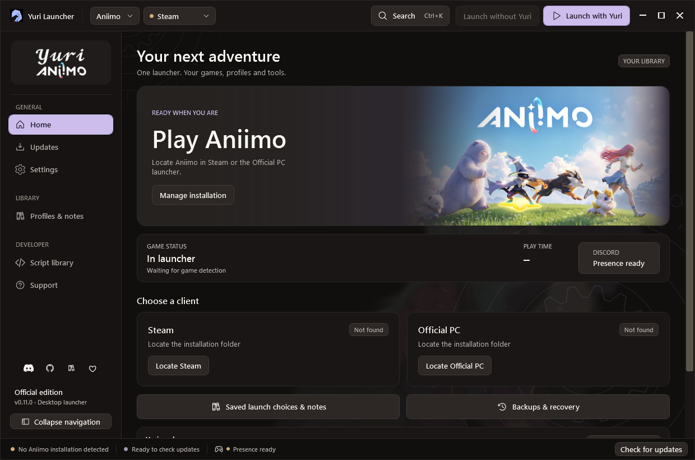
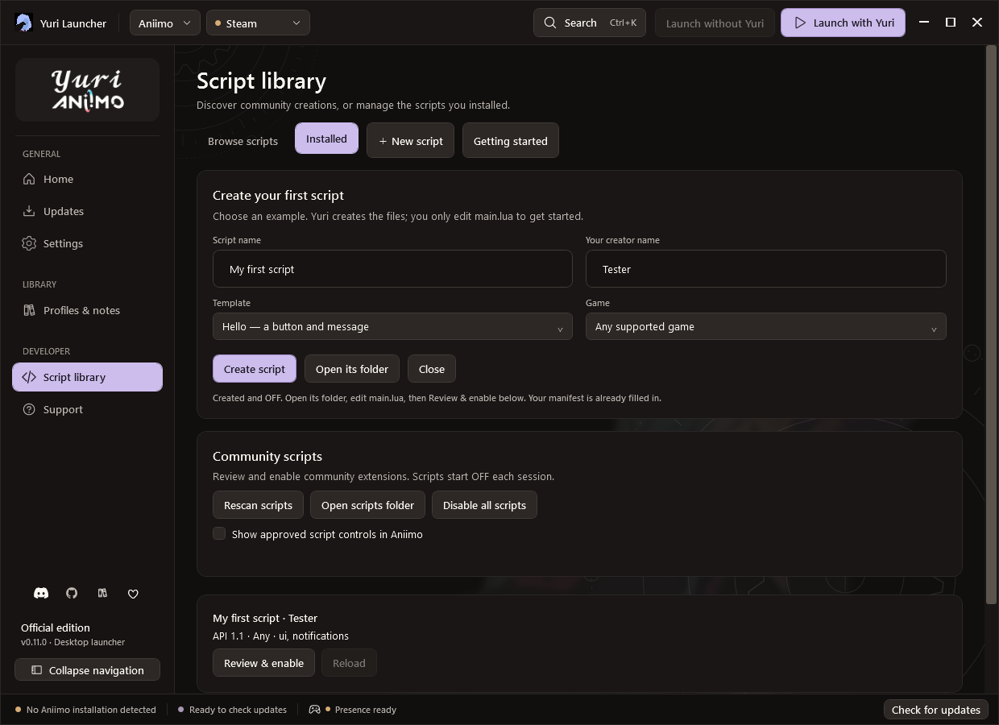

<p align="center"></p>
<h1 align="center">Yuri Launcher</h1>
<p align="center">One home for your Yuri games, scripts and updates.</p>
<p align="center"><a href="https://github.com/Slyrith/Yuri-Launcher/releases">Download</a> · <a href="https://github.com/Slyrith/Yuri-Lua">Lua scripts &amp; SDK</a> · <a href="https://discord.gg/DvP8UxQP3J">Community</a> · <a href="https://www.paypal.com/ncp/payment/ZFAGRQRSCT6SQ">Support Yuri</a></p>

Yuri Launcher brings your game installations, Yuri packages, scripts, profiles and diagnostics into one desktop app. Choose a game, select your client and launch from the same place.



## Start playing

1. Open [Releases](https://github.com/Slyrith/Yuri-Launcher/releases) and download **Yuri-Launcher-Official.zip**.
2. Extract the **whole ZIP** to a folder you can write to. Keep the worker, interpreter DLL, SDK and other files beside `YuriLauncher.exe`.
3. Run **YuriLauncher.exe normally**, choose Aniimo or Loftia, and let Yuri find your installation. Use **Settings → Installations** if you need to choose its location.
4. Choose **Launch without Yuri** for a normal game launch, or **Launch with Yuri** for your selected game-specific Yuri package.

If you do not have a Yuri game package selected yet, the Official launcher's **Updates → Download & install** flow can download, verify, extract and select a matching published package. You can also select an existing package using **Choose Yuri file** on Home.

**Requirements:** 64-bit Windows 10/11, .NET Framework 4.8, and your own installation/account for the game. Game-specific launchers may show their normal Windows or game prompts. The desktop launcher itself should run without administrator privileges when using community scripts.

## Everything in one place

- **Game library:** illustrated Aniimo/Loftia selection and remembered launch choices. Aniimo supports Steam and the Official PC client; Loftia uses Steam.
- **Managed updates:** verified SHA-256 downloads, complete package extraction, versioned folders and automatic executable selection.
- **Lua scripts:** browse the shared catalogue, review permissions, enable/disable scripts, and create your own from beginner templates.
- **Profiles and notes:** save how you launch and keep personal reminders.
- **Diagnostics:** local activity, session logs, copyable reports and installation checks.
- **Your desktop:** dark lavender/mint themes, animated background details, Discord presence in Official, and a matching Hide/Exit close prompt.

## Stay updated

The **Official edition** checks this repository for launcher releases on startup and **every 15 minutes while Yuri is running**, including while hidden in the system tray. **Check for updates** is always available manually. Turn automatic checking OFF in **Settings → Application** if you prefer.

- **Stable** follows the release marked **Latest** on GitHub.
- **Beta** checks releases marked **pre-release**. It does not silently fall back to Stable.
- A newer launcher version shows an update notice. Choose **Download launcher update**, then **Restart to update** when ready.
- Downloads are verified and staged beside existing packages. Yuri does not silently install an update or restart in the middle of your session. Restarting the launcher leaves your game open.
- Checks pause during an installation; temporary connection/rate-limit errors are retried at a later interval.

**Separate feeds:** this repository updates **Yuri Launcher**. [Yuri-Aniimo](https://github.com/Slyrith/Yuri-Aniimo) and [Yuri-Loftia](https://github.com/Slyrith/Yuri-Loftia) provide game-specific packages. [Yuri-Lua](https://github.com/Slyrith/Yuri-Lua) provides the shared script catalogue. Switching games does not change the desktop launcher's own update source.

Install launcher **0.11.0 or later once** to use this dedicated launcher feed. Earlier desktop builds may still need a manual download to make that switch.

## Make your first Lua script

Open **Script library → New script**, enter a name and your creator name, then choose an example. Yuri creates `script.json`, `main.lua` and editor hints for you. Start by editing `main.lua`:

```lua
yuri.button("Say hello", function()
    yuri.notify("Hello from my script!")
end)
```

SDK **1.1** includes simple controls/direct callbacks, typed saved settings, cancellable timers, event subscriptions, local logging and clearer errors. API 1.0 scripts remain supported. See the bundled **SDK/QUICKSTART.md** or the [Yuri-Lua repository](https://github.com/Slyrith/Yuri-Lua).

New and downloaded scripts begin **OFF**. Review each exact version before enabling it; changed source requires review again. Disabling a script stops its worker and timers. The current SDK improves authoring; broader gameplay data/actions still need tested game-specific adapters and remain planned. The sandbox has not undergone an independent security audit.



## Official or UC?

| Edition | Includes |
| --- | --- |
| **Official** | Online update feeds, public script-catalogue downloads, Discord presence and community/support links. |
| **UC** | Offline/manual updates, local scripts/catalogues and bundled documentation; online integrations are disabled. |

Download the edition you intend to use and extract it completely. Do not mix a worker or interpreter DLL from another build with the launcher.

## Need help?

- **Yuri is already running:** restore it from its system-tray icon. Change the X-button behavior in Settings → Application.
- **Game/package not found:** open Settings → Installations, or select your existing Yuri executable on Home.
- **No script cards yet:** the shared catalogue may still be empty. The bundled Hello Yuri example and New script templates are available locally.
- **A script stopped after editing:** review the changed version before enabling it again. Source errors point to `main.lua` and provide type/permission hints.
- **Reporting a problem:** include the launcher version, game/client, exact steps and your local diagnostic report. Review logs before sharing; they may include installation paths. No logs are uploaded automatically.

Use [Issues](https://github.com/Slyrith/Yuri-Launcher/issues) for reproducible launcher problems, or visit the [Yuri community](https://discord.gg/DvP8UxQP3J).

## Support the project

Yuri is free. If you would like to help its development, you can [support Yuri on PayPal](https://www.paypal.com/ncp/payment/ZFAGRQRSCT6SQ). Contributions are optional.

For release publishing, see [UPDATE-PUBLISHING.md](docs/UPDATE-PUBLISHING.md). Third-party notices and license texts are included with the downloadable packages.
